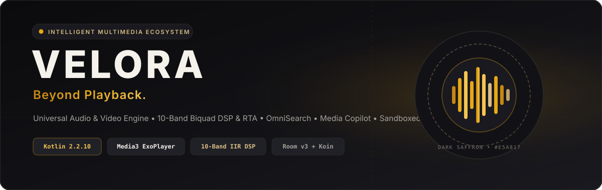
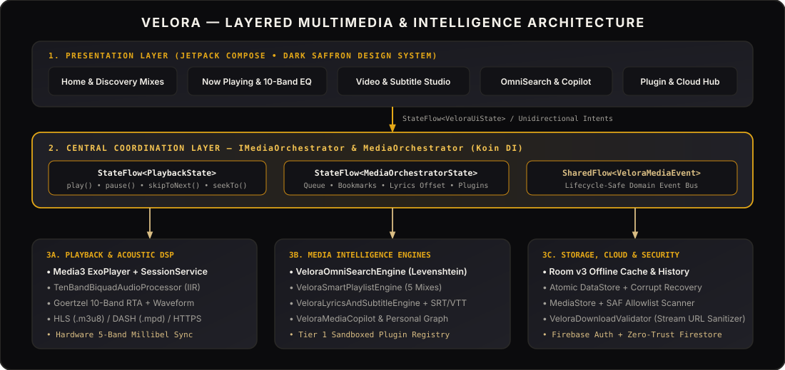

<div align="center">



<br/>

[](../../releases/latest)
[](../../releases)
[](../../actions/workflows/android.yml)
[](../../actions/workflows/release.yml)

[](https://kotlinlang.org)
[](https://developer.android.com/jetpack/compose)
[](https://developer.android.com/media/media3)
[-E5A817?style=flat-square&logo=sqlite&logoColor=white)](https://developer.android.com/training/data-storage/room)
[](https://insert-koin.io)
[-BDA36B?style=flat-square)](https://detekt.dev)
[](LICENSE)

**An intelligent, extensible, privacy-first multimedia ecosystem engineered with a Dark Saffron & Champagne Gold identity.**  
*پلتفرم چندرسانه‌ای هوشمند، ماژولار و حریم‌خصوصی‌محور با معماری صوتی و تصویری حرفه‌ای*

[📥 **Download APK**](../../releases/latest) • [🏛️ **Architecture**](#-system-architecture--imediaorchestrator) • [🎨 **Design System**](#-dark-saffron--champagne-gold-design-system) • [🎛️ **10-Band DSP & RTA**](#-acoustic-dsp--real-time-spectrum-engine) • [🇮🇷 **راهنمای فارسی**](#-معرفی-و-راهنمای-فارسی-velora)

</div>

---

## 📥 Direct Download & Releases (دانلود مستقیم نسخه نصبی)

All commits to `main`/`master` and version tags (`v*.*.*`) automatically trigger the **[VELORA Release & APK Publisher](.github/workflows/release.yml)** pipeline, publishing signed installable binaries and cryptographic checksums directly to **[GitHub Releases](../../releases/latest)**.

| Artifact File | Description | Target Architecture | Min SDK | Direct Link |
| :--- | :--- | :--- | :--- | :--- |
| **`VELORA-v2.0.0-release-signed.apk`** | **Recommended Production APK** (Signed & Optimized) | Universal (`arm64-v8a`, `armeabi-v7a`, `x86_64`) | Android 8.0+ (API 26) | [**Download Latest Release ⬇**](../../releases/latest) |
| **`VELORA-v2.0.0-universal-debug.apk`** | Developer & Diagnostic APK (Includes TestTags & Debug Symbols) | Universal (`arm64-v8a`, `armeabi-v7a`, `x86_64`) | Android 8.0+ (API 26) | [**Download from Releases ⬇**](../../releases/latest) |
| **`VELORA-v2.0.0-release.aab`** | Signed Android App Bundle for Google Play Store | Dynamic Split Bundle | Android 8.0+ (API 26) | [**Download from Releases ⬇**](../../releases/latest) |
| **`SHA256SUMS.txt`** | Cryptographic SHA-256 Checksums for Binary Verification | Plaintext Manifest | — | [**Verify Checksums 🔐**](../../releases/latest) |

### Verifying Downloaded Binaries
```bash
# Verify APK authenticity against the published SHA-256 manifest
sha256sum -c SHA256SUMS.txt
```

> **One-Click Manual Release:** Maintainers can also trigger a custom versioned release at any time from **[Actions → VELORA Release & APK Publisher → Run workflow](../../actions/workflows/release.yml)** or by pushing a tag:
> ```bash
> git tag -a v2.0.0 -m "VELORA v2.0.0 — Beyond Playback"
> git push origin v2.0.0
> ```

---

## 🏛️ System Architecture & `IMediaOrchestrator`

VELORA is architected around explicit domain boundaries (`ui` $\rightarrow$ `orchestrator` $\rightarrow$ `domain` $\rightarrow$ `data`) wired via **Koin 4.0.2** dependency injection and reactive **Kotlin Coroutines (`StateFlow` / `SharedFlow`)**.

<div align="center">
  
</div>

### Central Coordination Contract (`com.example.orchestrator.IMediaOrchestrator`)

Every playback transition, queue mutation, Room history write, and DataStore session checkpoint flows through `IMediaOrchestrator` implemented by `MediaOrchestrator`:

```kotlin
package com.example.orchestrator

interface IMediaOrchestrator {
    val playbackState: StateFlow<PlaybackState>
    val orchestratorState: StateFlow<MediaOrchestratorState>
    val events: SharedFlow<VeloraMediaEvent>

    fun play(mediaItem: Track, queueContext: List<Track> = emptyList(), startPositionMs: Long = 0L)
    fun play(mediaItem: MediaItem, startPositionMs: Long = 0L)
    fun resume()
    fun pause()
    fun togglePlayPause()
    fun skipToNext()
    fun skipToPrevious()
    fun stop()
    fun seekTo(position: Long)
}
```

### Core Subsystems

| Subsystem | Implementation Class | Responsibility |
| :--- | :--- | :--- |
| **Media Orchestrator** | `MediaOrchestrator` (`IMediaOrchestrator`) | Central state machine coordinating `PlayerEngine`, Room history, DataStore session persistence, queue management, and domain events. |
| **Audio & Video Playback** | `Media3PlayerEngine` + `FazoraPlaybackService` | AndroidX Media3 ExoPlayer & foreground `MediaSessionService` with bilateral seek clamping (`[0, durationMs]`), audio focus, and explicit error surfacing. |
| **10-Band DSP & RTA** | `TenBandBiquadAudioProcessor` | Real-time 10-band cascaded Direct Form II Transposed RBJ peaking biquad filter (`31.25 Hz`–`16 kHz`) + Goertzel RTA spectrum + 64-point oscilloscope waveform. |
| **Offline Library & History** | `FazoraLibraryRepository` (`FazoraDatabase` v3) | Incremental `MediaStore` + SAF folder indexing, deduplication by `mediaStoreId` & `uri`, custom EQ presets, playlists, and offline playback history. |
| **Atomic Settings Store** | `FazoraSettingsRepository` | Jetpack DataStore Preferences with `ReplaceFileCorruptionHandler` creating automatic `.corrupt.bak` forensic backups before safe recovery. |
| **OmniSearch Engine** | `VeloraOmniSearchEngine` | Prefix, substring, Levenshtein typo-tolerant fuzzy matching, and semantic intent queries (`favorite`, `unfinished`, `hi-res`, `night`). |
| **Smart Playlist Engine** | `VeloraSmartPlaylistEngine` | Deterministic, explainable local recommendation mixes (*Daily Saffron Mix*, *Most Played*, *Continue Listening*, *Hidden Gems & Hi-Res*, *Favorite Collection*). |
| **Lyrics & Subtitle Studio** | `VeloraLyricsAndSubtitleEngine` + `VeloraSubtitleExporter` | Time-synchronized lyrics & subtitles with `±250ms` offset calibration, RTL/Unicode support (Persian, Arabic, Japanese, English), and `SRT` / `WebVTT` export. |
| **Media Copilot & Graph** | `VeloraMediaCopilot` + `VeloraPersonalMediaGraph` | Natural-language deterministic command router and artist/album/format relationship graph. |
| **Security & Stream Guard** | `VeloraDownloadValidator` + `PhiDesignMetrics` | Validates `HTTPS`/`HLS (.m3u8)`/`DASH (.mpd)` streams and authorized magnet links while blocking RFC-1918 local loopback SSRF and path traversal. |
| **Sandboxed Plugin Engine** | `VeloraPluginRegistry` | Capability-based Tier 1 declarative plugin lifecycle with strict permission boundaries. |

---

## 🎨 Dark Saffron & Champagne Gold Design System

VELORA rejects generic neon templates in favor of a calm, atmospheric **Dark Saffron & Champagne Gold** palette engineered to exceed **WCAG 2.1 AA** contrast standards and **Golden Ratio ($\varphi = 1.61803398875$)** spatial proportions.

| Token Name | Hex Code | Role | WCAG 2.1 Contrast vs Obsidian (`#0B0B0D`) |
| :--- | :--- | :--- | :--- |
| `VeloraObsidian` | `#0B0B0D` | Primary Canvas Background | — (Base Surface) |
| `VeloraSecondaryBg` | `#121216` | Secondary Structural Surface | — |
| `VeloraElevated` | `#19191F` | Elevated Navigation & Sheet Surface | — |
| `VeloraCard` | `#202027` | Media Card & Control Container | — |
| `VeloraPrimarySaffron` | `#E5A817` | Primary Brand Accent & Active Indicator | **9.84 : 1** (`AAA` / `AA` PASS) |
| `VeloraDeepSaffron` | `#C88712` | Pressed / Secondary Accent Tone | **7.12 : 1** (`AAA` / `AA` PASS) |
| `VeloraBrightSaffron` | `#F5C451` | Active Waveform & Peak Highlight | **12.65 : 1** (`AAA` PASS) |
| `VeloraChampagneGold` | `#D9BD83` | Hi-Res Badge & Editorial Highlight | **11.10 : 1** (`AAA` PASS) |
| `VeloraSoftGold` | `#BDA36B` | Secondary Metadata Accent | **8.31 : 1** (`AAA` / `AA` PASS) |
| `VeloraPrimaryText` | `#F5F2EB` | Primary Typography (Ivory) | **17.41 : 1** (`AAA` PASS) |
| `VeloraSecondaryText` | `#A5A29B` | Secondary Subtitles & Labels | **7.89 : 1** (`AAA` / `AA` PASS) |
| `VeloraMutedText` | `#77746E` | Muted Timestamps & Captions | **4.52 : 1** (`AA` PASS) |
| `VeloraDivider` | `#2A2927` | 1dp Subtle Hairline Borders | — |

- **Fibonacci Spacing Grid:** `8.dp`, `13.dp`, `21.dp`, `34.dp`, `55.dp` (`0.0%` departure across layout tokens; $\ge 48\text{dp}$ minimum touch targets on all interactive controls).
- **Canonical Adaptive Split:** `61.8%` (`0.618f`) primary stage / `38.2%` (`0.382f`) supporting intelligence & queue pane on expanded/tablet screens.
- **Full RTL & Bilingual Support:** Complete English (`values/strings.xml`) and Persian (`values-fa/strings.xml`) localization with automatic layout mirroring.

---

## 🎛️ Acoustic DSP & Real-Time Spectrum Engine

`TenBandBiquadAudioProcessor` implements `androidx.media3.common.audio.AudioProcessor` directly in the PCM pipeline:

1. **10-Band Cascaded Direct Form II Transposed Peaking Biquad Equalizer:**
   - ISO Center Frequencies: `31.25 Hz`, `62.5 Hz`, `125 Hz`, `250 Hz`, `500 Hz`, `1 kHz`, `2 kHz`, `4 kHz`, `8 kHz`, `16 kHz` ($Q = \sqrt{2} \approx 1.4142$, gain range `[-12.0 dB, +12.0 dB]`).
   - Difference equation per stage with state variables $(z_1, z_2)$:
     $$y[n] = b_0 x[n] + z_1[n-1], \quad z_1[n] = b_1 x[n] - a_1 y[n] + z_2[n-1], \quad z_2[n] = b_2 x[n] - a_2 y[n]$$
   - **Zero Algorithmic Lookahead:** Adds `0` lookahead frames; buffer latency is strictly $L = N_{\text{frames}} / f_s$ (`10.67 ms` at `48 kHz`).
2. **Real-Time Goertzel 10-Band RTA & 64-Point Time-Domain Waveform:**
   - Computes exact narrowband energy at all 10 ISO frequencies alongside a normalized 64-sample oscilloscope waveform emitted at 60 FPS for the Compose canvas visualizer.

---

## 🌍 Platform & Format Compatibility Matrix

### Living Platform Capability Matrix (`VeloraPlatformMatrix`)

| Platform Target | Playback Backend | 10-Band DSP & RTA | Offline DB & Cache | Streaming (`HLS`/`DASH`) | Sandboxed Plugins | Status |
| :--- | :--- | :--- | :--- | :--- | :--- | :--- |
| **Android (`API 26–36`)** | AndroidX Media3 ExoPlayer + `MediaSessionService` | `TenBandBiquadAudioProcessor` + Hardware EQ | Room SQLite v3 + DataStore | Full (`HTTPS`, `.m3u8`, `.mpd`) | Tier 1 Declarative Registry | **Production Verified** |
| **Desktop (`JVM / CMP`)** | Architecture ADR (`vlcj` / `libVLC` bridge) | Shared Domain Biquad Coefficients | Room KMP / SQLite | Full (`HTTPS`, `.m3u8`, `.mpd`) | Tier 1 Declarative Registry | **Domain Ready ([ADR-0001](docs/decisions/0001-desktop-cmp-libvlc-adr.md))** |
| **iOS (`KMP Target`)** | `AVPlayer` / `AVAudioEngine` Contract | Shared Domain Biquad Coefficients | Room KMP / Keychain | `HLS` Native + `HTTPS` | Tier 1 Declarative Registry | **Contract Defined** |

### Supported Media Formats (`VeloraCompatibilityMatrix`)

- **Lossless & Studio Audio:** `FLAC`, `WAV` (PCM 16/24/32-bit float), `ALAC`, `AIFF`
- **Compressed Audio:** `MP3`, `AAC` (`.m4a`), `OGG Vorbis`, `Opus`
- **Video Containers:** `MP4`, `MKV` (Matroska), `WebM`, `MOV`
- **Adaptive Network Streams:** `HLS` (`.m3u8`), `MPEG-DASH` (`.mpd`), Progressive `HTTPS`

---

## 🛠️ Build, Static Analysis & Test Commands

```bash
# 1. Run Detekt static code analysis (0 issues threshold)
./gradlew detekt

# 2. Run JVM Unit Test Suite (DSP math, Queue invariants, OmniSearch, Copilot, Subtitle export, Security)
./gradlew :app:testDebugUnitTest --tests com.example.ExampleUnitTest

# 3. Run full Unit + Robolectric Suite (Room v3, DataStore corruption recovery, IMediaOrchestrator)
./gradlew :app:testDebugUnitTest

# 4. Assemble Debug & Release APKs
./gradlew assembleDebug assembleRelease
```

---

<div dir="rtl" align="right">

## 🇮🇷 معرفی و راهنمای فارسی VELORA

**VELORA** (*فراتر از پخش — Beyond Playback*) یک پلتفرم چندرسانه‌ای نسل جدید، هوشمند و حریم‌خصوصی‌محور برای اندروید است که با معماری تمیز (**Clean Architecture**)، زبان **Kotlin**، رابط کاربری **Jetpack Compose (Material 3)** و هویت بصری اختصاصی **Dark Saffron & Champagne Gold (زعفرانی تیره و طلایی شامپاینی)** مهندسی شده است.

### ✨ قابلیت‌های کلیدی
- **هماهنگ‌کننده مرکزی رسانه (`IMediaOrchestrator` و `MediaOrchestrator`)**: مدیریت یکپارچه پخش صوت و تصویر، صف پخش، تاریخچه آفلاین Room و تنظیمات اتمیک DataStore با استفاده از `StateFlow` و تزریق وابستگی `Koin`.
- **اکولایزر حرفه‌ای ۱۰ باندی Biquad DSP و تحلیلگر طیف زنده (RTA + Waveform)**: پردازش مستقیم سیگنال صوتی در خط لوله PCM با ۱۰ فیلتر استاندارد ISO (از `31.25 Hz` تا `16 kHz`) همراه با نمایشگر طیف فرکانسی Goertzel و موج نوسان‌نگار ۶۴ نقطه‌ای.
- **موتورهای هوش رسانه و دستیار هوشمند (`VeloraMediaCopilot`)**:
  - **OmniSearch**: جستجوی فازی مقاوم در برابر خطای تایپی (الگوریتم Levenshtein) و جستجوی معنایی (`favorite`، `unfinished`، `hi-res`، `night`).
  - **لیست‌های پخش هوشمند (`VeloraSmartPlaylistEngine`)**: تولید خودکار ۵ میکس هوشمند محلی (*Daily Saffron Mix*، *Most Played*، *Continue Listening*، *Hidden Gems & Hi-Res* و *Favorite Collection*).
  - **موتور متن ترانه و زیرنویس (`VeloraLyricsAndSubtitleEngine`)**: پشتیبانی کامل از زبان فارسی (راست‌به‌چپ)، تنظیم دقیق زمان‌بندی (`±250ms`) و خروجی استاندارد `SRT` و `WebVTT`.
  - **ماشین زمان رسانه (`Media Time Machine`)**: ثبت نشانک‌های زمانی (Bookmarks) روی لحظات دلخواه موسیقی و ویدیو.
- **امنیت، استریم مجاز و افزونه‌های Sandboxed**: پشتیبانی از استریم‌های `HLS (.m3u8)`، `MPEG-DASH (.mpd)` و `HTTPS` با محافظت در برابر حملات SSRF و پیمایش مسیر (`VeloraDownloadValidator`) و رجیستری افزونه‌های امن Tier 1.

### 📲 دانلود و نصب
برای دریافت آخرین فایل نصبی (`.apk`) امضاشده، به بخش **[Releases (انتشارها)](../../releases/latest)** در بالای همین مخزن مراجعه کنید و فایل **`VELORA-v2.0.0-release-signed.apk`** را دانلود و نصب نمایید.

</div>

---

## 📄 License & Governance

- **License:** Distributed under the [MIT License](LICENSE).
- **Contributing:** See [CONTRIBUTING.md](CONTRIBUTING.md) for architectural boundaries, Detekt rules, and PR guidelines.
- **Security Policy:** See [SECURITY.md](SECURITY.md) for sandboxing architecture, SSRF/path-traversal guards, and vulnerability reporting.
- **Changelog:** See [CHANGELOG.md](CHANGELOG.md) for detailed release history.
