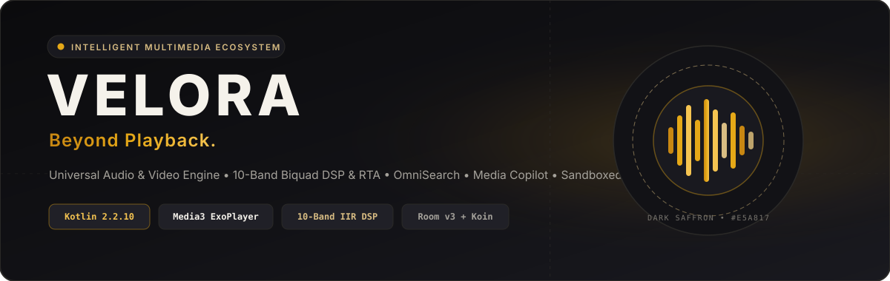
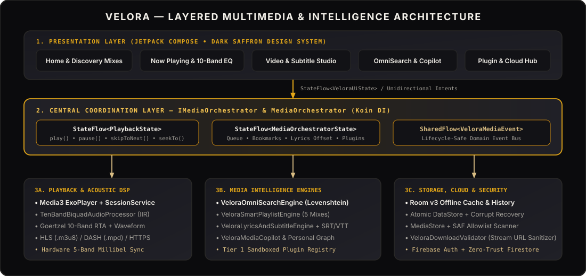

<div align="center">



# VELORA

**An offline-first Android music and video player with a 10-band equalizer, smart local library, and synced lyrics.**

[](https://github.com/aghorbani84/Velora/actions/workflows/android.yml)
[](https://github.com/aghorbani84/Velora/releases/latest)


[](LICENSE)

</div>

## Overview

VELORA is a native Android media player written in Kotlin with Jetpack Compose and AndroidX Media3 (ExoPlayer). It indexes the audio and video already on your device, plays them through a custom DSP pipeline, and keeps your library, playlists, and history in a local Room database. It targets Android 8.0+ (API 26) and supports English and Persian (RTL).

## Features

- **Audio and video playback** – Media3 ExoPlayer with a foreground `MediaSessionService` for background playback and system media controls; picture-in-picture for video
- **10-band equalizer** – cascaded biquad peaking filters from 31.25 Hz to 16 kHz applied in the PCM pipeline, with presets, custom presets, and a live spectrum/waveform visualizer
- **Local library** – incremental MediaStore and folder (SAF) scanning with de-duplication; audio (`mp3`, `flac`, `wav`, `ogg`, `m4a`, `aac`, `opus`) and video (`mp4`, `mkv`, `webm`, `mov`, `3gp`)
- **Playlists and history** – Room database (schema v4 with explicit migrations) for playlists, EQ presets, and playback history
- **Search and smart mixes** – fuzzy, typo-tolerant search and locally generated playlists (for example Most Played and Continue Listening)
- **Lyrics and subtitles** – time-synced lyrics/subtitles with offset adjustment, RTL text support, and SRT / WebVTT export
- **Bookmarks** – save timestamps inside tracks and videos
- **Radio** – curated and custom internet radio stations
- **Stream URL validation** – scheme allowlisting and manifest checks for HTTPS, HLS (`.m3u8`), and DASH (`.mpd`) links
- **Optional cloud playlists** – Google sign-in with Firebase Auth and Firestore playlist sync; the player works fully without it
- **Resilient settings** – Jetpack DataStore with corruption recovery that keeps a backup of the damaged file

## Download

Signed APKs and SHA-256 checksums are published on the [Releases page](https://github.com/aghorbani84/Velora/releases/latest). Verify a download with:

```bash
sha256sum -c SHA256SUMS.txt
```

## Tech stack

| Area | Tools |
| --- | --- |
| Language | Kotlin 2.2, Coroutines (`StateFlow` / `SharedFlow`) |
| UI | Jetpack Compose, Material 3, Navigation Compose, Coil |
| Playback | AndroidX Media3 1.5 (ExoPlayer, Session, UI) |
| Persistence | Room 2.7 (KSP), DataStore Preferences |
| Dependency injection | Koin 4 |
| Cloud (optional) | Firebase Auth, Cloud Firestore, Credential Manager |
| Quality | Detekt, Android Lint, JUnit, Robolectric |
| CI/CD | GitHub Actions (CI on pushes and PRs; release builds on `v*.*.*` tags) |

## Getting started

Requirements: JDK 21 (as used in CI) and the Android SDK (compile SDK 36).

```bash
git clone https://github.com/aghorbani84/Velora.git
cd Velora

./gradlew assembleDebug              # build a debug APK
./gradlew :app:testDebugUnitTest     # unit + Robolectric tests
./gradlew detekt lintDebug           # static analysis
```

Firebase sign-in and cloud playlists are optional: the app initializes them only when a Firebase configuration is present and otherwise runs fully offline. See [`CONTRIBUTING.md`](CONTRIBUTING.md) for project conventions.

## Architecture

The app follows a layered structure (`ui → orchestrator → domain → data`) wired with Koin. Every playback action, queue change, history write, and session checkpoint goes through a single `IMediaOrchestrator` implemented by `MediaOrchestrator`, which coordinates the `PlayerEngine`, Room, and DataStore.

<div align="center">
  
</div>

```
app/src/main/java/com/example/
├── orchestrator/   # IMediaOrchestrator contract
├── domain/         # engine (MediaOrchestrator, PlayerEngine) and models
├── data/           # playback (Media3, DSP), local (Room), scanner, settings, firebase
├── di/             # Koin modules
└── ui/             # Compose screens, components, navigation, theme, view models
```

More detail: [`docs/architecture.md`](docs/architecture.md) · [`docs/decisions/`](docs/decisions) · [`CHANGELOG.md`](CHANGELOG.md) · [`SECURITY.md`](SECURITY.md)

## License

Released under the [MIT License](LICENSE).

## Author

Built by [aghorbani84](https://github.com/aghorbani84).
